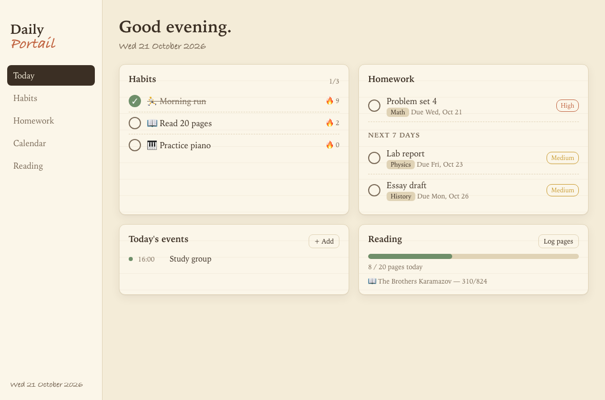
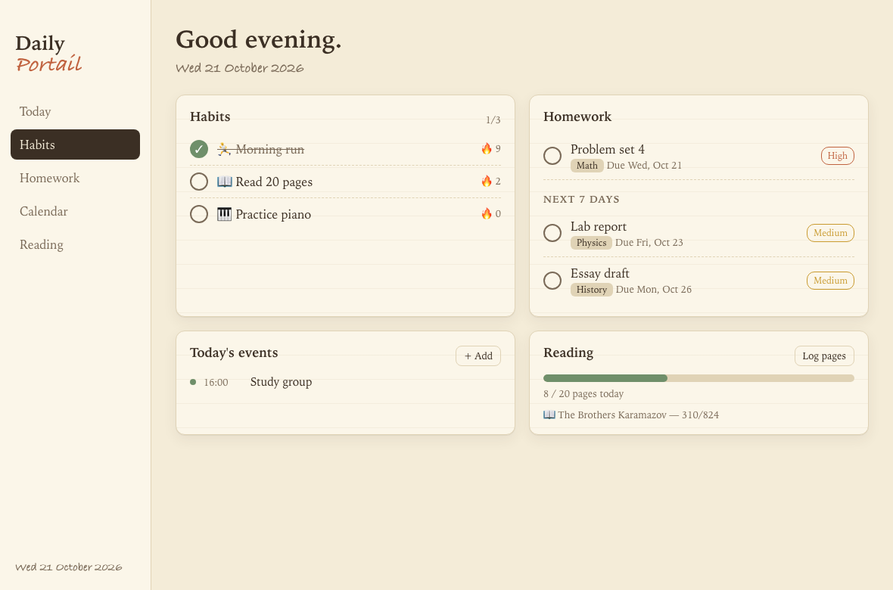
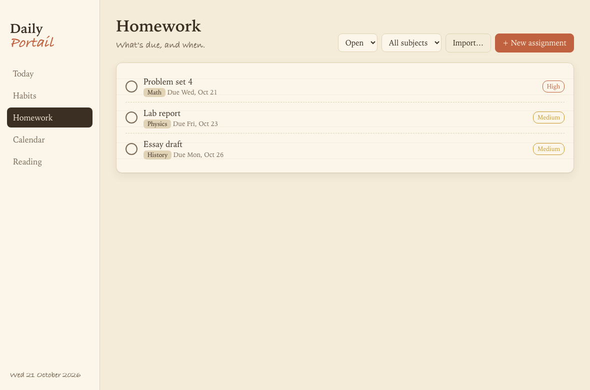
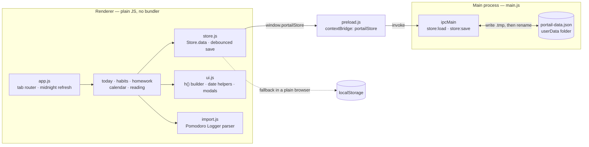

# Daily Portail

A personal daily-tracking app for macOS: habits, homework, calendar and reading, with a warm paper/journal look. Everything is stored locally on your Mac.

<p align="center">
  
  
</p>
<p align="center">
  
</p>

*Screenshots use sample data.*

## Features

- **Today** – one-screen dashboard: today's habits, homework due and overdue (plus the next 7 days), today's events, and reading progress.
- **Habits** – daily check-off, current and best streak, 12-week heatmap, optional weekday schedules.
- **Homework** – assignments with subject, due date, priority, notes/checklist; filter by status and subject; overdue highlighting.
- **Calendar** – month grid with your own events; open homework due dates appear as ring markers.
- **Reading** – books with page progress, a daily page goal, and a quick "Log pages" action.
- **Import** – load a Pomodoro Logger JSON export into Homework (see below).
- Light and dark themes follow the system setting.

## Install

Download the latest `.dmg` from the [Releases](https://github.com/Octavian-Mihai/daily_life_portail/releases) page, open it, and drag **Daily Portail** to Applications.

The builds are **Apple Silicon (arm64) only** and ad-hoc signed (not notarized by Apple), so on first launch right-click the app and choose **Open**.

If macOS says the app is "damaged and can't be opened", you have a build from before v1.1.1 that was missing a valid signature. Download the latest release, or clear the download flag:

```bash
xattr -cr "/Applications/Daily Portail.app"
```

## Importing from Pomodoro Logger

On the Homework tab, click **Import…** and pick a Pomodoro Logger export (`.json`).

| Pomodoro Logger | Daily Portail |
| --- | --- |
| Board | Subject |
| Card | Assignment (title, due date) |
| Card in the board's Done list, or fully ticked checklist | Done |
| Card content (`[ ] item` lines) | Notes / checklist |

Every imported assignment gets Medium priority. Re-importing a file skips cards that were already imported, and never overwrites tasks you have edited or completed. Focus-session records in the export are not imported.

## Data

All data lives in one JSON file in the app's user-data folder:

```
~/Library/Application Support/daily-portail/portail-data.json
```

Back it up by copying that file. (When the renderer is opened in a plain browser instead of Electron, it falls back to `localStorage`.)

## Development

Requires Node.js.

```bash
npm install
npm start        # run the app
npm run dist     # build dist/Daily Portail-<version>-arm64.dmg
```

### Project layout

```
main.js, preload.js     Electron main process and the storage bridge
renderer/               UI (plain HTML/CSS/JS, no build step)
  store.js              load/save state
  ui.js                 DOM helpers, date helpers, modal forms
  today.js habits.js homework.js calendar.js reading.js   one module per tab
  import.js             Pomodoro Logger parser (also runs under node)
build/                  app icon (icon.svg → icon.png → icon.icns)
```

### Regenerating the app icon

Edit `build/icon.svg`, then:

```bash
npx electron build/make-icon.js && sh build/make-icon.sh
```

## License

MIT

## Architecture

A small Electron app with no build step. The main process does one job, atomic reads and writes of a single JSON file; the
renderer is plain HTML/CSS/JS with one module per tab, all sharing one in-memory `Store`.



| Path | Purpose |
|---|---|
| `main.js` | Electron main process: window creation and the two IPC handlers that load and save the JSON file |
| `preload.js` | Exposes `portailStore.load/save` to the renderer through `contextBridge` (context isolation on, node integration off) |
| `renderer/index.html`, `styles.css` | Page shell and the paper/journal theme (light and dark) |
| `renderer/app.js` | Tab list, `draw()` re-render loop, midnight rollover |
| `renderer/store.js` | Default state, load/save, 150 ms debounced persistence, id generator |
| `renderer/ui.js` | `h()` DOM helper, date helpers, modal forms |
| `renderer/today.js`, `habits.js`, `homework.js`, `calendar.js`, `reading.js` | One module per tab; each exposes `render()` |
| `renderer/import.js` | Parses a Pomodoro Logger export into homework items (also runs under node for tests) |
| `build/` | Icon sources and generation scripts, and the ad-hoc signing hook (`after-pack.js`) |
| `dist/` | electron-builder output (`.dmg`, update manifest) |

## Design patterns

- **Single state object, render from scratch.** All data lives in `Store.data`; any change calls `Store.save()` then the global
  `rerender()`, which rebuilds the active tab. There is no per-widget state to get out of sync.
- **Module-per-feature with a common `render()` contract.** `app.js` holds a table of `[id, label, module]` and swaps the view,
  so adding a tab is one entry plus one file.
- **Narrow bridge between processes.** The renderer can only call `load` and `save`; it never touches the filesystem.
- **Atomic, debounced persistence.** Saves coalesce for 150 ms, are flushed on `beforeunload`, and the main process writes a
  temp file and renames it so a crash cannot leave half a file.
- **Graceful fallback.** The same `Store` uses `localStorage` when no Electron bridge exists, so the renderer also runs in a
  browser.
- **Tolerant loading.** Saved data is merged over fresh defaults, so older files gain new fields instead of breaking.
- **Idempotent import.** Re-importing skips cards already imported and never overwrites edited or completed tasks.
